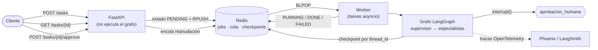
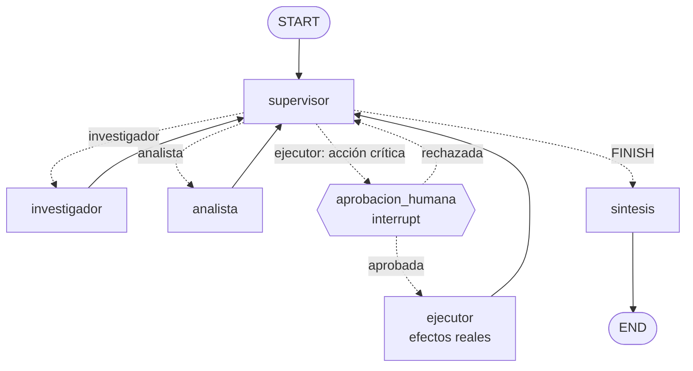

# API de producción para el orquestador multi-agente

API REST (**FastAPI**) que expone el orquestador multi-agente del Módulo 6 (supervisor + investigador + analista) con capacidades de producción:

- **Endpoints asíncronos con cola**: `POST /tasks` encola el trabajo y devuelve un `job_id` al instante; un worker lo ejecuta en segundo plano.
- **Redis** para el estado de los jobs (`PENDING / RUNNING / AWAITING_APPROVAL / DONE / FAILED`), para la cola y para los **checkpoints de LangGraph** (`AsyncRedisSaver`).
- **Observabilidad**: cada ejecución envía su traza a **Arize Phoenix** (o LangSmith), con tokens, costo y latencia por nodo.
- **Human-in-the-loop**: las acciones con efectos reales (enviar un email, emitir un reembolso) pausan el grafo hasta que una persona las aprueba por `POST /tasks/{id}/approve`.

## Arquitectura



El grafo (supervisor, investigador, analista, aprobación humana, ejecutor y síntesis):



## Estructura

```
├── app/
│   ├── main.py            # FastAPI: POST /tasks, GET /tasks/{id}, GET /health
│   ├── hitl.py            # nodo de aprobación humana (interrupt) + POST /tasks/{id}/approve
│   ├── graph.py           # orquestador del M6 + checkpointer de Redis
│   ├── supervisor.py      # supervisor con rúbrica y frenos duros
│   ├── worker.py          # ejecuta jobs en segundo plano y actualiza el estado en Redis
│   ├── jobs.py            # estado de los jobs y cola, ambos en Redis
│   ├── observability.py   # inicialización de Phoenix / LangSmith
│   ├── runtime.py         # arma Redis + checkpointer + grafo (API y worker)
│   ├── config.py, state.py, data_base.py
│   └── agents/            # investigador, analista y ejecutor (acciones críticas)
├── scripts/load_test.py   # prueba de carga: N peticiones concurrentes
├── tests/                 # pruebas automáticas (sin OpenAI ni Docker)
├── screenshots/           # capturas del dashboard (evidencia)
├── docker-compose.yml     # Redis Stack + Phoenix + API
├── Dockerfile, requirements.txt, .env.example
```

## Cómo levantar el entorno

Requiere **Python 3.12**. Hay dos formas de tener Redis y el dashboard:

| | Redis | Dashboard | Qué necesitás instalar |
|---|---|---|---|
| **A (recomendada)** | Docker (`redis-stack-server`) | Phoenix en Docker | [Docker Desktop](https://www.docker.com/products/docker-desktop/) |
| **B (sin Docker)** | [Redis Cloud](https://redis.io/try-free/) gratis | LangSmith (nube) | Solo cuentas gratuitas |

> El checkpointer de LangGraph (`AsyncRedisSaver`) usa los módulos **RedisJSON y RediSearch**, que vienen en Redis Stack y en Redis Cloud, pero no en un Redis común.

### 1. Entorno Python y variables

```bash
py -3.12 -m venv venv
venv\Scripts\activate
pip install -r requirements.txt
copy .env.example .env
```

Abrí `.env` y completá `OPENAI_API_KEY` (el `.env` está en `.gitignore`: nunca se sube).

### 2A. Redis y Phoenix con Docker

```bash
docker compose up -d redis phoenix
```

Phoenix queda en <http://localhost:6006> y Redis en `localhost:6379`. El `.env.example` ya apunta a ambos (`REDIS_URL=redis://localhost:6379/0`, `OBSERVABILITY=phoenix`).

### 2B. Sin Docker: Redis Cloud + LangSmith

1. Creá una base gratuita en Redis Cloud y copiá su URL (`redis://default:<password>@<host>:<puerto>`) en `REDIS_URL`.
2. Creá una cuenta en [LangSmith](https://smith.langchain.com/), generá una API key y en `.env` poné:
   ```
   OBSERVABILITY=langsmith
   LANGSMITH_API_KEY=lsv2_...
   ```

### 3. Levantar la API

```bash
uvicorn app.main:app --port 8000
```

Chequeo: <http://localhost:8000/health> debe mostrar `"status": "ok"` y la observabilidad `"active": true`. La documentación interactiva (Swagger) está en <http://localhost:8000/docs>.

> Todo en Docker, incluida la API: `docker compose up -d --build` (usa `OPENAI_API_KEY` del `.env`).

## Cómo probarla

La forma más simple en Windows es la interfaz de <http://localhost:8000/docs> (botón **Try it out**). Con `curl` (Git Bash o Linux/macOS):

```bash
# 1. Encolar: responde enseguida con el job_id
curl -X POST localhost:8000/tasks -H "content-type: application/json" \
  -d '{"pregunta": "Calculá la calificación promedio de la Tarjeta Plus y su costo a 3 años."}'

# 2. Consultar el estado (repetir hasta DONE o FAILED)
curl localhost:8000/tasks/<job_id>
```

### Probar el Human-in-the-loop

Pedí una acción con efectos reales:

```bash
curl -X POST localhost:8000/tasks -H "content-type: application/json" \
  -d '{"pregunta": "Calculá la calificación promedio de la Tarjeta Plus y enviá un reporte con ese dato a ana@example.com"}'
```

El job pasa por `RUNNING` y queda en **`AWAITING_APPROVAL`**: el grafo está pausado y el email **no** se envió. `GET /tasks/<job_id>` muestra en `aprobacion_pendiente` qué acción espera decisión. Para resolverla:

```bash
curl -X POST localhost:8000/tasks/<job_id>/approve -H "content-type: application/json" \
  -d '{"approved": true, "comentario": "ok"}'      # o "approved": false para rechazar
```

Si se aprueba, el job continúa y termina en `DONE`; si se rechaza, el supervisor cierra explicando que la acción **no se ejecutó**.

## Prueba de carga: 5 peticiones concurrentes

Con la API y el dashboard levantados:

```bash
python -m scripts.load_test            # 5 peticiones a la vez contra localhost:8000
```

El script las envía en paralelo, espera a que terminen e imprime la latencia de cada una (extremo a extremo), p50, p95 y máximo. Guarda `load_test_results.json` con los `job_id` y la ventana de tiempo para ubicar esas trazas en el dashboard.

### Qué capturar del dashboard (guardar en `screenshots/`)

En Phoenix (<http://localhost:6006>, proyecto `agente-multiagente-api`) o en LangSmith (proyecto del mismo nombre), filtrando por la ventana de la corrida:

1. **Trazas**: lista de trazas de la corrida y el detalle de una (árbol supervisor → especialistas → llamadas al LLM, con tokens de entrada/salida por nodo).
2. **Costo por ejecución**: la plataforma lo calcula sola a partir de los tokens (columna de costo en la tabla de trazas y el panel de costo del proyecto).
3. **Latencia p95**: el panel de latencia del proyecto. Los dashboards muestran percentiles de la latencia de las trazas (en Phoenix, el panel de percentiles de latencia del proyecto; en LangSmith, el gráfico de latencia), pero no siempre exactamente el p95. Capturá lo que muestra tu dashboard y, si no incluye el p95, anotá en este README el p95 que calcula `scripts/load_test.py` sobre las mismas 5 corridas.

Cada job genera **una sola traza** (llamada `job-<primeros 8 caracteres del job_id>`), así que el costo y la latencia por traza equivalen al costo y la latencia por ejecución. Las llamadas HTTP de la propia API (`POST /tasks`, `GET /tasks/...`) no se trazan a propósito, para que no ensucien los percentiles.

Qué mirar al leerlo: qué nodo concentra la latencia (casi siempre las llamadas al LLM del supervisor, que se repiten en cada vuelta) y qué nodo consume más tokens (el analista y la síntesis reciben los datos completos).

## Diseño y decisiones

- **No bloquea el event loop**: todo es `async` nativo (`redis.asyncio`, `ainvoke`, `astream`). Los endpoints solo leen/escriben en Redis y nunca ejecutan el grafo. Un test automático comprueba que `POST /tasks` responde en milisegundos con 5 jobs corriendo y que los 5 avanzan en paralelo.
- **Cola en Redis**: la API hace `RPUSH` a `jobs:queue` y los workers `BLPOP`. El worker corre dentro de la API (tareas asyncio, `WORKER_CONCURRENCY=5`) o como proceso aparte con `python -m app.worker`; ambos leen la misma cola.
- **Errores en segundo plano → `FAILED`**: cualquier excepción del grafo se captura en el worker y el job pasa a `FAILED` con el error en Redis. También hay un timeout por job (`JOB_TIMEOUT_SECONDS`), de modo que el cliente nunca queda esperando indefinidamente.
- **Persistencia**: el `thread_id` de LangGraph es el `job_id`, así que los checkpoints en Redis permiten pausar un grafo en el nodo de aprobación (aunque pase un día o se reinicie el servidor) y reanudarlo exactamente donde quedó.
- **HITL por construcción**: el grafo no tiene ninguna arista que lleve al `ejecutor` sin pasar por `aprobacion_humana`. Que una acción sea crítica no depende de que el LLM "se acuerde" de pedir permiso. El nodo no tiene efectos antes de `interrupt()` (al reanudar, LangGraph lo vuelve a ejecutar desde el principio).
- **Doble decisión protegida**: aprobar es una transición atómica (`WATCH/MULTI`); si dos personas deciden a la vez, la segunda recibe `409`.
- **Frenos contra bucles**: `recursion_limit=30` en el grafo, máximo de 8 decisiones del supervisor, máximo de intervenciones por especialista (el ejecutor, 1) y timeout por job.
- **Trazabilidad**: cada corrida lleva `job_id`, `thread_id` y `session_id` como metadata, así que se puede buscar la traza de un job en el dashboard.

### Limitaciones conocidas

- La cola usa `BLPOP`: entrega *como máximo una vez*. Si el proceso se cae justo mientras ejecuta un job, ese job queda en `RUNNING` y habría que reencolarlo a mano. Para más garantías haría falta una cola con confirmación (Redis Streams, Arq o Celery).
- El apagado de la API es ordenado (espera hasta 5 s a que los jobs en curso terminen) y marca como `FAILED` los que no alcanzan.
- `AsyncRedisSaver` requiere Redis Stack (o Redis Cloud); con un Redis común falla al iniciar con un mensaje explicativo.
- Los efectos secundarios (email, reembolso) están **simulados**: se registran en memoria, no se envía nada real.

## Pruebas automáticas

```bash
pip install -r requirements-dev.txt
pytest
```

Usan un LLM falso y `fakeredis` (o un Redis real si se define `REDIS_TEST_URL`), así que no gastan tokens ni necesitan Docker. Cubren: encolado y resultado, validación de entrada, no bloqueo del event loop con 5 jobs concurrentes, `FAILED` ante excepciones y timeouts, pausa/aprobación/rechazo del HITL (verificando que el efecto no ocurre sin aprobación), `409` en doble decisión y reanudación tras un reinicio.

## Variables de entorno

| Variable | Para qué | Por defecto |
|---|---|---|
| `OPENAI_API_KEY` | Modelo de lenguaje | — (obligatoria) |
| `REDIS_URL` | Redis (jobs, cola y checkpoints) | `redis://localhost:6379/0` |
| `OBSERVABILITY` | `phoenix`, `langsmith` o `none` | `none` |
| `PHOENIX_COLLECTOR_ENDPOINT` / `PHOENIX_PROJECT_NAME` | Phoenix | `http://localhost:6006` / `agente-multiagente-api` |
| `LANGSMITH_API_KEY` / `LANGSMITH_PROJECT` | LangSmith | — |
| `OPENAI_MODEL` | Modelo | `gpt-4o-mini` |
| `WORKER_CONCURRENCY` | Jobs simultáneos por proceso | `5` |
| `RUN_WORKER_IN_API` | Worker dentro de la API | `true` |
| `JOB_TIMEOUT_SECONDS` | Timeout por job | `180` |

## Evidencia

_Pendiente: capturas del dashboard en `screenshots/` (trazas, costo por ejecución y latencia de las 5 peticiones concurrentes) y resultado de `python -m scripts.load_test`._
